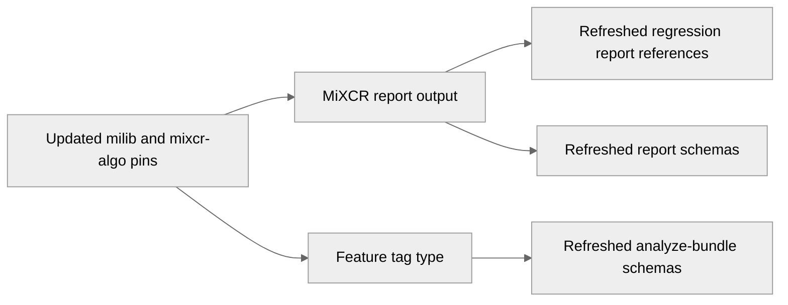

# Issue

**Title:** MILAB-6874: bump milib to 3.5.0-31 and mixcr-algo to 4.7.0-72-develop

## Description

Moves MiXCR to milib `3.5.0-31-master`, which carries the assemble memory changes: packed sequences, narrow trie, alignment cache, and the 8 GiB sorter cap.

- mixcr-algo `4.7.0-70-develop` → `4.7.0-72-develop`. That is the develop build of milaboratory/mixcr-algo#154, which bumped mitool to `2.3.1-172-main`.
- milib `3.5.0-22-master` → `3.5.0-31-master`. mixcr pins milib explicitly, so the pin has to change here as well.
- Regression references updated (merged from #2148). These are schema and field changes only, with no count changes. All three come from intended mitool commits:
  - `commandLine` is now empty in the parse, refine-tags and consensus reports (mitool `2453874`, "Deprecate command field for all reports").
  - A new `perSampleMatched` field in the parse and align reports (mitool `c56fc0e`).
  - A new `Feature` tag type in the schema enums (the MILAB-6496 work).

## Testing

### 1. CI

Run `36114785073` on `4ee4d014`: 89 jobs passed, 9 skipped, 0 failed.

- **Unit tests.** CI downloads and prepares the `yf_sample_data` fixtures, so the 23 fixture-dependent tests that could not run locally ran here: 0 failures. These are `CommandExportClonesTest`, `CommandExportAlignmentsTest`, and the overlap, postanalysis and dummy integration tests.
- **Integration tests.** All `:test (int)` cases passed. They include the `*_reproducible_hash` cases (the same build run twice gives byte-identical `.vdjca`/`.clna`/`.clns`) and `regression_{clns,clna,vdjca,shmt}` (files from old MiXCR versions still read correctly).
- **Regression snapshots.** `baseSingleCell`, `baseBuldTrees` and `export-meta` compare exported reports against committed references. They changed only as described above.

### 2. Local build (JDK 11, the version MiXCR targets and CI uses)

- `shadowJar` compiles cleanly. `runtimeClasspath` resolves milib `3.5.0-31-master`, mitool `2.3.1-172-main` and mixcr-algo `4.7.0-72-develop`.
- In `mixcr-all.jar`, the bundled `*-build.properties` read milib `3.5.0-31-master` (`5d57b1cfdd`), mitool `2.3.1-172-main` (`a5a4c1c40b`) and mixcr-algo `4.7.0-72-develop` (`6358e9188f`).
- `./gradlew test`: 175 run, 23 failed, 12 skipped. The failures are the same 23 as on unmodified develop. They are NPEs on fixtures that cannot be generated locally without a MiXCR license. CI runs them; see above.

### 3. Output equivalence against develop (otter1, 2026-09-25)

This branch's jar and a develop `71e1fb33` jar ran side by side on the same input, using the mixcr-amplicon-alignment block's argv (`generic-amplicon`, alpaca, `--rna`, VDJRegion) at `-Xmx100g`. Input: synthetic bulk amplicon `LS10M_Library_Rep1`. The comparison covered every numeric field of the align and assemble reports, the clone export with `cloneId` dropped and rows sorted, and the raw export file.

| Arm | Input | Clustering | Clones | Result |
|---|---|---|---|---|
| A | 10 M read pairs | off (block setting) | 3,844,710 | byte-identical export, including `cloneId` and row order; align (38) and assemble (30) report fields all equal |
| C | first 1 M pairs | on | 383,800 | same |

| Arm | assemble, develop | assemble, this branch |
|---|---|---|
| A | 1038 s, peak RSS 106.5 GB | 1024 s, peak RSS 82.5 GB (−22.5%) |
| C | 4481 s, peak RSS 34.0 GB | 2236 s, peak RSS 25.0 GB (2.0x faster, −27%) |

Each timing is one run, with both builds on one host. Peak RSS at `-Xmx100g` shows how much memory the process took, not the live heap.

Limits:
- Synthetic data only.
- In arm C, clustering searched across all clones but merged only 4 reads, the same in both builds. So the code path where clusters get merged was hardly exercised.
- Single-cell, UMI and scFv paths were not run through this comparison. They are covered only by the CI tests above.
- A clustering-on run over the full 10 M pairs was stopped because its ETA was 19–66 h.

### 4. Memory profiling (otter0, 2026-09-23)

Assemble memory with milib `3.5.0-31` (V2) against the shipped 4.7.0-347 on milib `3.5.0-20` (V0), on bulk amplicon `LS10M_Library_Rep1`. B1 is 10% of it (about 0.45 M clones) and B2 is 33% (about 1.4 M clones).

| Measure | V0 | V2 | Change |
|---|---|---|---|
| B1 smallest passing grant | 11 GiB | 9 GiB | Xmx 7.58 → 5.58, −26% |
| B1 live set at Xmx 93.5 | 10.93 GiB | 6.61 GiB | −40% |
| B1 live set at Xmx 15.58 | 7.29 GiB | 4.94 GiB | −32% |
| B2 live set at Xmx 93.5 | 28.96 GiB | 17.59 GiB | −39% |
| B2 max heap after GC | 33.71 GiB | 27.06 GiB | −20% |

Limits:
- V2 was built from `MILAB-6874_align-clonotype-estimate` (HyperLogLog clonotype estimate in align), not from this branch.
- No build with milib as the only change ran, so the effect of milib alone is not isolated.
- JDK 21.0.12 (V0) against 21.0.12.1 (V2).
- Only bulk B1 and B2 were measured. Single-cell (`refineTagsAndSort`), UMI data and larger inputs were not.

Related MILAB-6874 memory research (ptabler sizing, not the milib assemble changes):

<!-- greptile_comment -->

<!-- greptile_summary -->

<h2><a href="https://app.greptile.com/api/retrigger?id=69240665"><picture><source media="(prefers-color-scheme: dark)" srcset="https://greptile-static-assets.s3.amazonaws.com/badges/RetriggerDark.svg?v=2"><source media="(prefers-color-scheme: light)" srcset="https://greptile-static-assets.s3.amazonaws.com/badges/Retrigger.svg?v=2"></picture></a>Confidence Score: 5/5</h2>

<!-- greptile-risk -->

The PR appears safe to merge; no new actionable issue or outstanding previous finding was identified.

<h3>Summary</h3>

MiXCR updates its mixcr-algo and milib pins and refreshes regression references for the resulting report and schema output.
- **milib** — the explicitly pinned library dependency; updated from `3.5.0-22-master` to `3.5.0-31-master`.
- **mixcr-algo** — the algorithm dependency; updated from `4.7.0-70-develop` to `4.7.0-72-develop`.
- **`commandLine`** — a report field recording command arguments; the MiTool parse, refine-tags, and consensus references now contain an empty string.
- **`perSampleMatched`** — per-sample matching data in tag-parsing reports; added to report references and schemas.
- **`Feature`** — a tag-type enum value; added to the affected analyze-bundle schema references.

Diagram

<!-- greptile_confidence_score:5 -->

Reviews (3) · Last reviewed commit: 

<!-- /greptile_comment -->

## Task

Modify the repository so that the issue described above is resolved. The repository is checked out at base commit `71e1fb33667e`. Edit files in place; the verifier captures your changes via `git diff` and scores them against an oracle patch using SWE-RL-style diff-similarity reward.