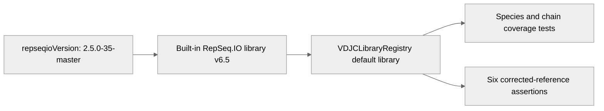

# Issue

**Title:** Bump repseqio to 2.5.0-35-master (library v6.5)

## Description

Bumps repseqio to `2.5.0-35-master`, which makes RepSeq.IO library [v6.5](https://github.com/milaboratory/library/releases/tag/v6.5) the built-in default (milaboratory/repseqio#47).

- `build.gradle.kts`: `repseqioVersion` `2.5.0-31-master` → `2.5.0-35-master`
- `changelogs/v4.7.1.md`: reference library section updated to v6.5
- `DefaultLibraryTest`: rhesus, cynomolgus and rat resolve from the built-in library, with functional V and J for IGH, IGK, IGL, TRA and TRB; the six corrected references are checked individually

v6.5 adds IGK and IGL for rhesus and cynomolgus macaque, and IGH, IGK and IGL for rat. It corrects rhesus IGHV3-182, IGHV4-86, IGHV5-189 and TRBC2, cynomolgus TRAV24 and rat TRAV3-4. `repseqio.v6.4` stays available via `--library repseqio.v6.4`.

<!-- greptile_comment -->

<!-- greptile_summary -->

<h2><a href="https://app.greptile.com/api/retrigger?id=71200361"><picture><source media="(prefers-color-scheme: dark)" srcset="https://greptile-static-assets.s3.amazonaws.com/badges/RetriggerDark.svg?v=2"><source media="(prefers-color-scheme: light)" srcset="https://greptile-static-assets.s3.amazonaws.com/badges/Retrigger.svg?v=2"></picture></a>Confidence Score: 5/5</h2>

<!-- greptile-risk -->

The PR appears safe to merge; no outstanding finding or new actionable issue was identified.

<h3>Summary</h3>

The PR updates the built-in RepSeq.IO library from v6.4 to v6.5, documents the added references, and tests the new species coverage and corrected genes.
- **Important touched terms:** `repseqioVersion` is the Gradle dependency version; it changes to `2.5.0-35-master`. `Species` is the test case describing a taxon, chains, and representative V gene; it gains rhesus, cynomolgus, and rat entries. `VDJCLibraryRegistry` provides the built-in default reference library; the new test queries it for corrected genes. `GeneVariantName` identifies a library gene variant; the new assertions use it to select six variants. `GeneFeature` identifies an annotated gene region; the test now checks `VIntron`, `CExon1`, and `VTranscript`.

Diagram

<!-- greptile_confidence_score:5 -->

Reviews (2) · Last reviewed commit: 

<!-- /greptile_comment -->

## Task

Modify the repository so that the issue described above is resolved. The repository is checked out at base commit `16907dab7f96`. Edit files in place; the verifier captures your changes via `git diff` and scores them against an oracle patch using SWE-RL-style diff-similarity reward.