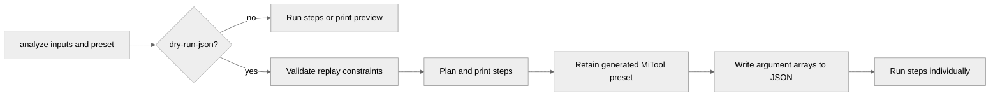

# Issue

**Title:** MILAB-6874: analyze --dry-run-json and dry run of mitool presets

## Description

## Why

The Platforma block `mixcr-clonotyping` is moving from one `mixcr analyze` job to one exec per step, so each step can get its own CPU and memory. Today the block re-implements analyze's step planning in Tengo. With this change, the block can ask analyze for its steps up front and run them one by one. Any preset of a given MiXCR version, built-in or from a file, then runs exactly as analyze would run it.

## What

### `--dry-run-json <file>`

A new hidden option on `analyze`. It works the same as `--dry-run`: it prints every step and runs none. It also writes the same steps to a JSON file, so the block knows every step before it runs any:

```json
{
  "formatVersion": 1,
  "steps": [
    ["mitool", "parse", "--report", "out/sample.parse.report.txt", "--preset", "local:out/sample.MiTool.preset", "--save-output-file-names", "out/sample.parse.list.tsv", "R1.fastq.gz", "R2.fastq.gz", "out/sample.parsed.mic"],
    ["mitool", "refine-tags", "--report", "out/sample.refineTags.report.txt", "out/sample.parsed.mic", "out/sample.refined.mic"],
    ["mitool", "consensus", "--report", "out/sample.consensus.1.report.txt", "out/sample.refined.mic", "out/sample.consensus.1.mic"],
    ["align", "--report", "out/sample.align.report.txt", "--json-report", "out/sample.align.report.json", "--preset", "10x-sc-xcr-vdj", "--species", "hs", "out/sample.consensus.4.mic", "out/sample.alignments.vdjca"],
    ["assemble", "--report", "out/sample.assemble.report.txt", "--json-report", "out/sample.assemble.report.json", "out/sample.extended.vdjca", "out/sample.clna"],
    ["exportClones", "out/sample.assembledCells.clns", "out/sample.clones.tsv"]
  ]
}
```

This is shortened. The real 10x file has 15 steps. Each step is one printed `--dry-run` line without the leading `mixcr`, so it is the argument list to pass to `mixcr`.

`--dry-run-json` never overwrites: it refuses an existing steps file or `MiTool.preset.yaml`, with or without `-f`, and refuses a missing parent folder. It also refuses what the written steps cannot carry: `--intermediates-in-temp` (that folder is removed when the dry run exits; use `--intermediates-dir`), `--remove-intermediates` (the steps hold no deletion) and sample sheet input (per-sample names only exist at run time).

### Dry run of mitool presets

Before this change, `--dry-run` failed for every preset that starts with `mitool parse`, for example `10x-sc-xcr-vdj`:

```
java.nio.file.NoSuchFileException: out.parse.list.tsv
```

After it runs parse, analyze reads the sample file list that parse writes. A dry run never runs parse, so that list does not exist. Now:

- A dry run does not read the list. The next steps use the planned names, which are the names parse writes unless it splits the reads by sample. `align` already did the same for its own list.
- `--dry-run-json` keeps `<prefix>.MiTool.preset.yaml` and does not delete it on exit, so the written `mitool parse --preset local:...` step can run afterwards. Plain `--dry-run` and a normal run still delete it.

A normal analyze run and plain `--dry-run` are otherwise unchanged.

### Known limits

- If the tag pattern has a sample tag, parse or align splits by it and the per-sample names only exist after the step has read the data. The printed names are correct for a single sample only. Sample sheet input is refused; a sample tag in the pattern is not detected.
- The steps reference presets by name. A file preset must be reachable from the folder where the steps run; the plan does not copy it.
- An export that splits by chain prints the output name it is given (for example `clone.groups.tsv`), not the per-chain files it writes. Normal analyze does the same.

## Tests

- `CommandAnalyzeDryRunTest`:
  - 10x is planned to the end: parse, refine-tags, 4 consensus rounds and align. Each step reads what the previous one wrote, and the preset file exists.
  - The JSON steps equal the printed lines, for 10x and rna-seq.
  - An existing JSON file or preset file is kept, with and without `-f`. A missing parent folder, `--intermediates-in-temp` and `--remove-intermediates` are rejected.
  - For `milab-human-dna-xcr-7genes-multiplex`, `mikelov-et-al-2021`, `10x-sc-xcr-vdj` and `rna-seq`, the JSON steps run one by one in a fresh folder give the same `.clns`/`.clna` clone counts and TSVs as `analyze`.
- New itests on `single_cell_vdj_t_subset` with 10x, from the JSON file (`case-analyze_dry_run_json`) and from the printed lines (`case-analyze_dry_run_mitool`): 7 clones, the same as `analyze`, and byte-identical TSVs.
- All `cli` unit tests pass. The itests `case-intermediates`, `case001` and `case-qc` pass.

<!-- greptile_comment -->

<!-- greptile_summary -->

<h2><a href="https://app.greptile.com/api/retrigger?id=72722653"><picture><source media="(prefers-color-scheme: dark)" srcset="https://greptile-static-assets.s3.amazonaws.com/badges/RetriggerDark.svg?v=2"><source media="(prefers-color-scheme: light)" srcset="https://greptile-static-assets.s3.amazonaws.com/badges/Retrigger.svg?v=2"></picture></a>Confidence Score: 5/5</h2>

<!-- greptile-risk -->

The PR appears safe to merge; no new actionable issue remains from the changes since the previous review.

<h3>Summary</h3>

The PR adds a replayable JSON step plan for `analyze` and lets dry runs plan MiTool parse-first presets through their later steps.
- **Execution plan:** the ordered commands `analyze` would run; dry runs now collect each command’s argument list for JSON output.
- **MiTool preset:** generated parse configuration; JSON planning retains it for replay, while a plain dry run does not.
- **Parse file list:** names produced by a running parse step; dry-run planning uses planned names because no list is produced.
- **Sample sheet:** input that supplies sample-specific information; JSON planning now rejects it because the resulting output names are determined at run time.
- Unit and integration tests cover plan contents, replay, output comparisons, and rejected options.

<details><summary>Diagram</summary>


</details>

<!-- greptile_confidence_score:5 -->

<sub>Reviews (5) · Last reviewed commit: </sub>

<!-- /greptile_comment -->

## Task

Modify the repository so that the issue described above is resolved. The repository is checked out at base commit `cac04148d4a5`. Edit files in place; the verifier captures your changes via `git diff` and scores them against an oracle patch using SWE-RL-style diff-similarity reward.